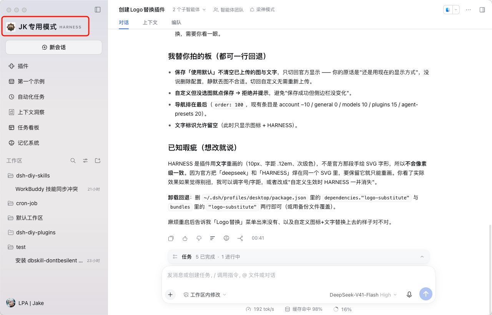
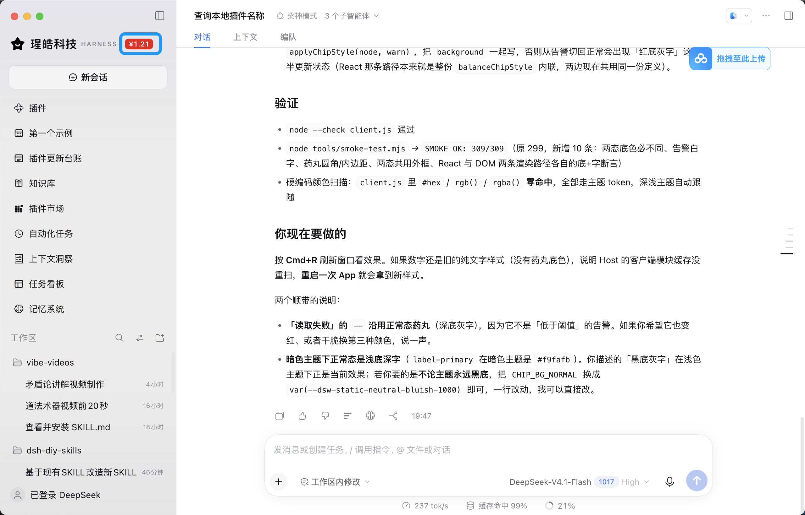
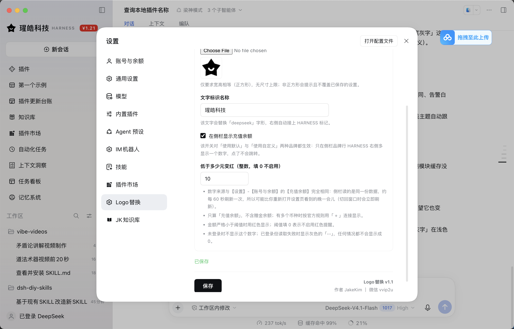

# dsh-logo-substitute

DSH（DeepSeek Harness）Web GUI 品牌替换 + 充值余额显示插件。

> **自用声明**：本项目是作者**自用**的小工具，顺手开源给小范围的朋友共用，按 **MIT** 协议授权。

> 旧名 `logo-substitute`，v1.1 起更名为 `dsh-logo-substitute`。配置仍沿用原来的 localStorage key
> `logo-substitute:v1`，改名不会丢已有的图标与文字。

## 功能

1. **品牌替换**：把侧边栏顶部的鲸鱼标志与 `deepseek` 字形换成自定义正方形图标与文字，HARNESS 标记保留。
2. **充值余额**：在品牌行 HARNESS 右侧显示「充值余额」，与【设置】-【账号与余额】的【充值余额】**同一数据源**；
   可关闭，可设阈值，低于阈值变红。

## 设置入口

【设置】-【Logo替换】，两个标签：

| 标签 | 内容 |
|---|---|
| 使用默认 | 侧栏恢复官方品牌（鲸鱼 + deepseek 字形）；自定义图片与文字保留，随时可切回 |
| 使用自定义 | 图标（正方形图片）、文字标识名称、**在侧栏显示充值余额**、**低于多少元变红**（整数元阈值） |

余额开关与阈值放在「使用自定义」标签下，但**对两种品牌模式都生效**。反过来说：若当前停留在「使用默认」标签，
要改这两项得先点一下「使用自定义」标签、改完再点回「使用默认」保存（「保存」在页脚，与该标签无关）。

## 余额显示规则

| 情况 | 表现 |
|---|---|
| 已登录、读取成功 | 深底浅灰字的药丸，显示金额如 `¥12.34`（浅色主题下即「黑底灰字」） |
| 金额严格小于阈值（且阈值 > 0） | 同一位置换成**红底白字**药丸 |
| 未登录 | 不显示 |
| 已登录但读取失败 | 灰色 `--`（任何情况都不会显示成 0） |
| 开关关闭 | 不显示 |
| 侧栏折叠 | 不显示（折叠态只有图标，没有品牌名） |

- **不含赠金余额**，只算「充值余额」；多币种按官方规则用 ` + ` 连接（如 `¥1.00 + $2.00`）。
- **阈值只比较 CNY 充值钱包**；填 0 表示不启用红色提醒；阈值必须是整数元。
- 数字每 60 秒刷新，窗口重新聚焦 / 页面重新可见时立即刷新；不可点击（点击穿透给品牌按钮，不影响「新建会话」）。
- **样式**：两态都是圆角药丸，只换底与字——
  正常 `background: --dsw-alias-label-primary` + `color: --dsw-alias-label-tertiary`（深底灰字）；
  告警 `background: --dsw-alias-state-error-primary` + `color: --dsw-static-neutral-bluish-00`（红底纯白字）。
  告警态刻意用静态白色而不是 `--dsw-alias-label-primary-foreground`：后者会随主题反转，暗色主题下变成深字压红底。
  「未登录」不渲染，「读取失败」的 `--` 沿用正常态药丸（它不是告警）。

## 数据来源（为什么不自己算钱）

宿主半调用 cordis 服务 `accountController.getBalance()`——与官方【设置】-【账号与余额】页同一次调用；
金额排版逐字复刻官方的 `formatBalance`：

```
v == 0            -> ¥0.00
0 < v < 0.01      -> <¥0.01
v >= 0.01         -> ¥ + 千分位 + 两位小数（向下截断）
v < 0             -> -¥ + (|v| > 0.01 ? 四舍五入到两位 : 0.01)
```

这条规则**正负不对称**（正数截断、负数四舍五入）是官方原样行为，本插件照抄，不是笔误——
一改成对称就会与设置页的显示永久分叉。

浏览器半只消费一条同源接口，不依赖任何 `@deepseek-ai/*` 客户端包：

```
GET /plugins/dsh-logo-substitute/balance
{ ok, status: "ready" | "signed-out" | "failed" | "unavailable",
  display, primaryCny, wallets: [{currency, balance, display}], bonusWallets: [...], fetchedAt, error? }
```

宿主端 15 秒进程内缓存（`?force=1` 绕过），浏览器端 60 秒轮询，避免频繁打到 Platform 接口。

## 安装（本机）

目录名即包名。profile 用 `link:` 引用源码目录：

```bash
/Applications/DeepSeek\ Harness.app/Contents/Resources/runtime/cli/bin/dsh \
  plugin --profile desktop add link:/Users/jake/workspace/dsh_space/dsh-diy-plugins/dsh-logo-substitute
```

两个坑：

1. profile 的 `dsh.profile.bundles` 是**显式有序清单**，`dsh plugin` 只把参数转发给 pnpm、不会改它。
   改包名后必须同步把 `~/.dsh/profiles/desktop/package.json` 里 bundles 的旧名换成 `dsh-logo-substitute`，
   否则启动时该 bundle 会被跳过（stderr 出现 `skipping profile bundle` 警告），插件等于没装。
2. v1.1 新增了宿主路由。实测 `dsh plugin add` 会让运行中的 Host 重新装载宿主半（路由立即可用），
   但**浏览器半要刷新一次窗口**（Cmd+R）才会拿到新的客户端行；刷新后若侧栏仍是旧表现，再重启 App。
   此后修改宿主代码若路由未生效，同样重启一次即可。

## 已知取舍

- **官方品牌模式下的挂载方式**：默认品牌的名字是 SVG 字形，无法用 React 渲染进它内部，所以 chip 用
  `[class*="brandName"]` 定位品牌名 span 后 `appendChild` 到末尾，并用 `MutationObserver` 兜住 React 重渲染。
  失败模式是良性的（chip 不出现），不影响侧栏本身；自定义模式由 React 正常渲染，两者不会重复显示。
- 不依赖任何 `@deepseek-ai/*` 客户端包（私有不稳定 API），浏览器半只 `require('react')`。
- 颜色只用主题 token：`--dsw-alias-label-tertiary`（正常）/ `--dsw-alias-state-error-primary`（告警），深浅色自动跟随。

## 测试

```bash
node tools/smoke-test.mjs        # 浏览器半：SMOKE OK: n/m
node --test tools/host-test.mjs  # 宿主半：formatBalance / 路由 / 缓存
```

## 示例
### 修改Logo后的界面

### 余额不足的显示

### Logo替换插件的设置


## 版本

- **v1.2.0** —— 余额改为实心药丸：正常态深底灰字，低于阈值为红底白字（`--dsw-static-neutral-bluish-00` 静态白，
  不会在暗色主题下反转成深字）。
- **v1.1.0** —— 更名 `dsh-logo-substitute`；新增宿主半与充值余额显示（开关 / 阈值 / 红色告警）。
- v1.0.0 —— 品牌替换（图标 + 文字 + HARNESS）。

本项目为作者自用工具，按 MIT 协议开源。软件按「原样」提供，不附带任何形式的担保。
作者 JakeKim ｜ 微信 vvip2u
